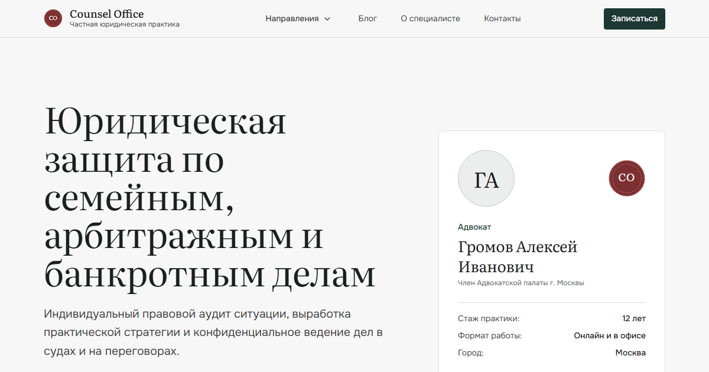

# Counsel Office

Лендинг частной юридической практики: семейное право, арбитражные споры, банкротство.
Демо-проект — компания, специалист и контакты вымышлены.

**Демо:** [counsel-office.vercel.app](https://counsel-office.vercel.app)



## Что есть на сайте

- Главная: первый экран, направления практики, этапы работы, о специалисте, FAQ, статьи, контакты.
- Страницы направлений с перелинковкой на статьи и формой записи с выбранным направлением.
- Блог с фильтром по категориям и страницами статей.
- Форма записи на консультацию: маска телефона, валидация, honeypot от ботов, явное
  согласие на обработку персональных данных. Заявки попадают в Google Таблицу через
  Google Apps Script ([apps-script/](apps-script/)).
- Адаптивная вёрстка для десктопа и телефонов, мобильное меню, модальное окно записи.
- Доступность: skip link, семантическая разметка, управление фокусом в модальном окне и после отправки формы.
- SEO: мета-теги и Open Graph для каждой страницы, JSON-LD (Attorney, Person, Service, BlogPosting).

## Стек

- React 19, React Router 7 (SPA), TypeScript в строгом режиме
- Vite 6, Tailwind CSS 4 с дизайн-токенами (`src/styles/tokens.css`)
- Google Apps Script + Google Sheets для приёма заявок
- ESLint 9 (в том числе `jsx-a11y`), Prettier, unit-тесты на `node:test`
- Деплой на Vercel

## Структура

```text
src/
├── app/layout/      # шапка, подвал, мобильное меню, общий каркас
├── features/        # home, practice, blog, consultation, legal-pages, not-found
├── shared/          # UI-кит, хуки, конфиги, SEO, API
├── styles/          # токены и базовые стили
└── router.tsx       # маршруты
apps-script/         # код веб-приложения для Google Таблицы
test/                # unit-тесты
```

## Как сделано

Проект собран с помощью Claude Code: я ставил задачи агенту, разбирал предложенные
решения и проверял результат в браузере на десктопе и мобильной ширине. Код держится
в рамках жёстких проверок: строгий TypeScript, ESLint с правилами доступности,
Prettier и unit-тесты.

Перед публикацией в портфолио провёл с агентом аудит готового сайта: typecheck, линт,
тесты, ручной проход всех страниц и формы, проверку прямых ссылок на проде и превью ссылок.
Найденное исправлено отдельными PR:

- [#1](https://github.com/KufuVampire/counsel-office/pull/1) — 404 на прямых ссылках
  к внутренним страницам на Vercel, мета-теги вели на несуществующий домен;
- [#2](https://github.com/KufuVampire/counsel-office/pull/2) — мобильное меню без
  затемнения, ссылки на разделы главной со внутренних страниц, вёрстка карточек и формы,
  заглушки в данных, пустая OG-картинка;
- [#3](https://github.com/KufuVampire/counsel-office/pull/3) — форма не отправляла
  заявки, согласие на обработку данных стояло по умолчанию.

## Запуск

```bash
npm install
npm run dev          # dev-сервер
npm run typecheck    # проверка типов
npm run lint         # ESLint
npm test             # unit-тесты
npm run build        # продакшн-сборка
```

Адрес скрипта для заявок задан в `src/shared/config/site.ts` и переопределяется
переменной `VITE_CONSULTATION_ENDPOINT`. Как развернуть свой скрипт — в
[apps-script/README.md](apps-script/README.md).

## Лицензия

MIT, см. [LICENSE](./LICENSE).
